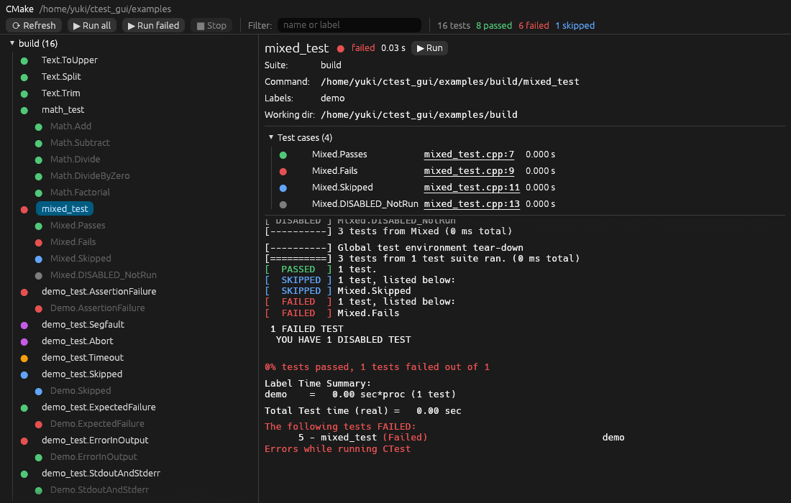

# ctest_gui (`ctgui`)

<p align="center">
  
</p>

<p align="center">
  
  
  
  
  
  
</p>

- This repository provides a GUI that helps you discover and run tests registered with ctest.
- It supports ROS 2 colcon workspaces in addition to regular CMake projects.
- The GUI itself is written in Rust because it makes distribution easy.

## Technology Stack

- Programming language: Rust
- GUI framework: egui / eframe
- Target OS: Ubuntu 22.04 or later

## Installation

- The following command installs the latest version from GitHub Releases into `~/.local/bin`.

```bash
curl -fsSL https://raw.githubusercontent.com/OWNER/ctest_gui/main/install.sh | sh
```

- You can uninstall it with the following command.

```bash
curl -fsSL https://raw.githubusercontent.com/OWNER/ctest_gui/main/install.sh | sh -s -- --uninstall
```

## Features

| Feature             | Description                                                                                  |
| ------------------- | -------------------------------------------------------------------------------------------- |
| Workspace detection | Automatically detects build directories containing `CTestTestfile.cmake`, or ROS 2 packages. |
| Test discovery      | Gets test names, commands, and labels from the output of `ctest --show-only=json-v1`.        |
| Filtering           | Filters the list by a partial match on test names or labels.                                 |
| Running             | Runs all tests, failed tests, a whole suite, or individual tests.                            |
| Stopping            | Stops running tests together with their process group.                                       |
| Output view         | Shows the output of the selected test in real time.                                          |
| Result types        | Shows passed, failed, timeout, crashed, skipped, and disabled tests in different colors.     |
| GoogleTest support  | Shows the result and source location of each `TEST()` after a run.                           |

### Editor Settings

- The editor used for jumping to code can be set with the `CTGUI_EDITOR` environment variable.
- `{file}`, `{line}`, and `{column}` are replaced with the file path, line, and column respectively.

```bash
export CTGUI_EDITOR="code -g {file}:{line}:{column}"
export CTGUI_EDITOR="gnome-terminal -- vim +{line} {file}"
```

## Examples

- `examples` is a GoogleTest-based C++ project for trying out ctgui.

```bash
sudo apt install -y cmake libgtest-dev
```

- You can build it and open it in ctgui with the following commands.

```bash
cmake -S examples -B examples/build
cmake --build examples/build
ctgui examples
```

- The following executables are provided, one for each way of registering tests.

| Executable   | Registration                                        | Description                                                    |
| ------------ | --------------------------------------------------- | -------------------------------------------------------------- |
| `math_test`  | Registered as a single ctest test with `add_test`   | Multiple `TEST()` cases that all pass.                         |
| `text_test`  | Registered per `TEST()` with `gtest_discover_tests` | Each `TEST()` appears as its own ctest test.                   |
| `mixed_test` | Registered as a single ctest test with `add_test`   | Contains passed, failed, skipped, and disabled `TEST()` cases. |
| `demo_test`  | Registered per `TEST()` with `--gtest_filter`       | Tests for checking the various kinds of ctest results.         |

- The following screenshot shows the results of running all tests in the examples.



## Development

### Building

- First, set up a Rust development environment with rustup by following the official instructions.
- Next, install the system packages required to build egui.

```bash
sudo apt install -y build-essential libxkbcommon-dev libxcb-render0-dev \
  libxcb-shape0-dev libxcb-xfixes0-dev libgl1-mesa-dev
```

- Then you can build it with the following command.

```bash
cargo build --release
```

- To install it from the build, use the following command.

```bash
cargo install --path .
```

- To uninstall what you installed, use the following command.

```bash
cargo uninstall ctgui
```

### Testing

- Unit tests are run with the following command.

```bash
cargo test
```

- Static analysis and format checks are run with the following commands.

```bash
cargo clippy -- -D warnings
cargo fmt --check
```

### Releasing

- Update `version` in `Cargo.toml` and commit it.
- Push a tag with the same version, and GitHub Actions builds the binaries and creates a release.

```bash
git tag v0.1.0
git push origin v0.1.0
```

## License

- This software is dual-licensed under the [MIT License](LICENSE-MIT) and the [Apache License 2.0](LICENSE-APACHE).
- You may use it under either license at your option.
- Unless you explicitly state otherwise, any contribution to this repository is provided under the same dual license.
